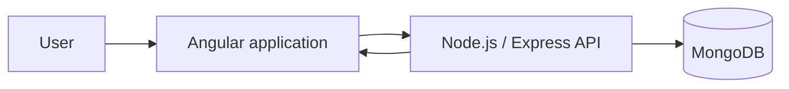

<div align="center">

# Mahfazty

### Full-stack personal finance tracker built with Angular, Node.js, and MongoDB


[](https://angular.dev/)
[](https://nodejs.org/)
[](https://www.mongodb.com/)

</div>

> [!NOTE]
> **Demo availability:** Mahfazty was developed as a portfolio and learning project using free-tier infrastructure. Any hosted frontend, API, or database may sleep, expire, or become temporarily unavailable. The repository and local setup remain the reliable evaluation paths.

## Overview

Mahfazty helps users record income and expenses, organize transactions by category, and inspect financial summaries through an Angular dashboard.

The project demonstrates end-to-end web development rather than claiming banking-grade security or operation as a regulated financial product.

## Features

- User registration and authentication
- Protected frontend routes
- Income and expense CRUD operations
- Transaction categories and filtering
- Monthly and category-based summaries
- Interactive dashboard charts
- Responsive Angular interface
- REST API integration

## Architecture



## Technology stack

| Layer | Technology |
| --- | --- |
| Frontend | Angular, TypeScript, RxJS, Chart.js |
| Backend | Node.js, Express.js |
| Database | MongoDB and Mongoose |
| Authentication | JWT-based application authentication |
| Styling | Responsive CSS and component styles |

## Repository structure

```text
Mahfazty/
├── backend/
│   ├── models/
│   ├── routers/
│   ├── middlewares/
│   └── util/
├── frontend/
│   └── src/app/
│       ├── pages/
│       ├── services/
│       ├── interfaces/
│       └── partials/
└── README.md
```

## Local setup

### 1. Clone the repository

```bash
git clone https://github.com/shawky2002020/Mahfazty.git
cd Mahfazty
```

### 2. Configure and run the backend

```bash
cd backend
npm install
```

Create a local `.env` file using your own values:

```env
MONGO_URI=your_mongodb_connection_string
SECRET=your_jwt_secret
PORT=5000
```

Then start the API using the script defined in `backend/package.json`.

### 3. Run the frontend

```bash
cd ../frontend
npm install
npm start
```

Use the exact script names available in the repository package files if they differ.

## Security scope

This project implements normal portfolio-level application controls, including authentication, protected routes, password hashing where configured, and server-side ownership checks.

It does **not** claim:

- banking-grade security;
- regulatory compliance;
- independent security auditing;
- encryption of every application field;
- suitability for storing real financial-account credentials.

Do not use real banking passwords, card data, or sensitive financial secrets in this project.

## Demo and deployment status

| Surface | Status |
| --- | --- |
| Frontend deployment | May be unavailable because of free-tier hosting |
| API deployment | May sleep or cold-start |
| Database | Requires an active configured MongoDB instance |
| Local setup | Supported with valid environment variables |
| Source review | Public and available |

## Current project status

Mahfazty is an earlier full-stack portfolio project. It remains useful for evaluating Angular, Node.js, MongoDB, authentication, API integration, and dashboard fundamentals, while newer repositories better represent current architecture and production-delivery experience.

## Author

**Shawky Elsayed**  
Full-Stack Software Engineer  
https://www.shawkyelsayed.com
